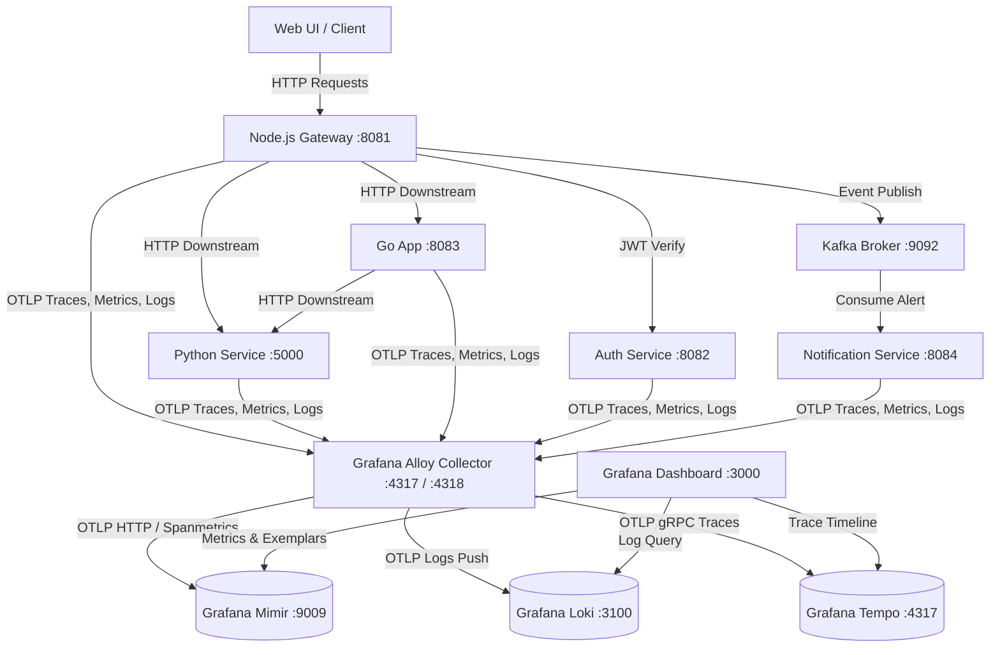
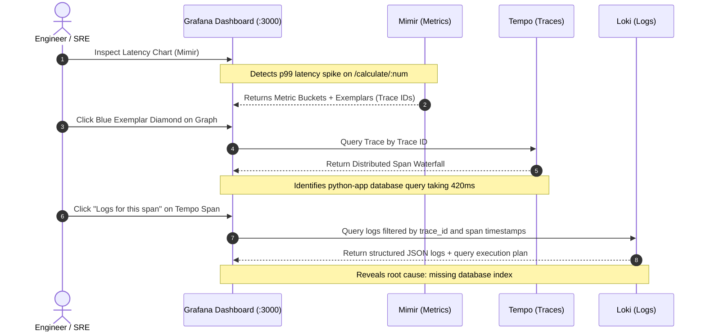

# ⚡ LGTM Observability Mesh & Polyglot Microservices Architecture

<p align="center">
  
  
  
  
  
</p>

A production-ready microservice demonstration and reference architecture for the **Grafana LGTM (Loki, Grafana, Tempo, Mimir) Stack** combined with **Grafana Alloy** as the next-generation telemetry collector, **PostgreSQL** database infrastructure, **Apache Kafka** event streaming, **Redis** caching, and a **7-microservice polyglot application mesh** written in Node.js, Python, and Go.

Includes an interactive **Glassmorphic Web UI Dashboard** with a **3D WebGL Topology Diagram**, OpenTelemetry distributed tracing, metrics-to-traces exemplars, OTLP log correlation, and a zero-overhead **`ENABLE_OBSERVABILITY` feature flag**.

> 📦 **Want to use the Telemetry SDKs in your own services?** Check out the complete [LGTM Packages Usage Guide (Python, Node.js, Go)](PACKAGES_GUIDE.md).

---

## 🏛️ What is the LGTM Stack?

The **LGTM Stack** represents Grafana Labs' unified, cloud-native observability platform engineered around the three fundamental pillars of observability—**Metrics, Logs, and Traces**—consolidated under a single glass pane:

```
                            ┌─────────────────────────────────────────┐
                            │          G — Grafana Dashboard          │
                            │   Single Pane of Glass Visualization    │
                            └────────────────────┬────────────────────┘
                                                 │
            ┌────────────────────────────────────┼────────────────────────────────────┐
            ▼                                    ▼                                    ▼
┌───────────────────────┐            ┌───────────────────────┐            ┌───────────────────────┐
│     L — Loki          │            │     T — Tempo         │            │     M — Mimir         │
│  Log Aggregation      │            │  Distributed Tracing  │            │  Time-Series Metrics  │
│  "Like Grep for Logs" │            │  High-Scale & Low-Cost│            │  Horizontally Scalable│
└───────────────────────┘            └───────────────────────┘            └───────────────────────┘
            ▲                                    ▲                                    ▲
            │                                    │                                    │
            └────────────────────────────────────┴────────────────────────────────────┘
                                                 │
                                     ┌───────────────────────┐
                                     │     Grafana Alloy     │
                                     │ OpenTelemetry Pipeline│
                                     └───────────────────────┘
```

### 1. 📜 L — Grafana Loki (Logs)
* **Metadata-Only Indexing**: Unlike traditional full-text indexers (e.g. Elasticsearch/OpenSearch) that index entire log payloads, Loki indexes **only labels** (the same label schema as Prometheus). Log chunks are compressed and stored in cheap object storage (or local disks).
* **Massive Cost Efficiency**: Consumes up to **90% less storage** and requires significantly less memory, preventing cluster out-of-memory crashes while allowing high-throughput ingestion.
* **LogQL Power**: Query and filter logs with expressions identical to PromQL (e.g. `{job="node-app"} |= "error" | json | latency_ms > 200`).
* **Trace Context Injection**: Logs contain injected `trace_id` and `span_id` tags, enabling instant 1-click jumps from error lines directly into distributed traces.

### 2. 📊 G — Grafana (Visualization & Correlation)
* **Unified Single Pane**: Blends metrics, logs, traces, alerts, and node topology into a single synchronized interface.
* **Bi-Directional Telemetry Hopping**:
  * **Metrics ➔ Traces**: Click a latency spike exemplar diamond on a Prometheus/Mimir graph to load the exact root-cause trace in Tempo.
  * **Traces ➔ Logs**: From any span in a Tempo trace timeline, click "Logs for this span" to jump to Loki filtered precisely to that span's microsecond window.
  * **Logs ➔ Traces**: Click the blue `trace_id` badge on an error log line to render its distributed trace waterfall instantly.

### 3. ⏱️ T — Grafana Tempo (Distributed Tracing)
* **High-Volume Trace Storage**: Tempo is an object-storage-backed distributed tracing backend that does not require indexing trace data. Instead, it uses indexed trace IDs and integration with Prometheus/Loki to retrieve traces on demand.
* **No Sampling Compromise**: Massive cost savings make 100% trace capture feasible, ensuring edge-case errors and intermittent latency spikes are never missed.
* **W3C Trace Context Standard**: Interoperates seamlessly with OpenTelemetry standards across polyglot microservice boundaries (HTTP, gRPC, and asynchronous Kafka messages).

### 4. 📈 M — Grafana Mimir (Long-Term Prometheus Metrics)
* **Horizontally Scalable Time-Series**: 100% compatible with Prometheus queries and metrics, architected for multi-tenant, petabyte-scale long-term metric storage.
* **Microsecond Query Acceleration**: Uses horizontally partitioned queriers, store-gateways, and compactor engines to evaluate complex PromQL aggregations over months of retention.
* **Spanmetrics & Exemplars**: Ingests RED (Rate, Errors, Duration) metrics derived dynamically from OpenTelemetry trace spans, attaching exemplar trace IDs to metric histogram buckets.

### 5. 🔄 Telemetry Backbone: Grafana Alloy
* **Unified Telemetry Collector**: Grafana's official distribution of the OpenTelemetry Collector with built-in Prometheus agent and Promtail capabilities.
* **Declarative Component Graph**: Configured using Alloy syntax (`otelcol.receiver`, `otelcol.processor`, `otelcol.exporter`, `loki.process`), creating flexible pipelines that normalize and route telemetry from all 7 polyglot services to the respective LGTM backends simultaneously.

---

## 📐 Architecture & Data Flow Workflow

### System Architecture Topology

```
                          +-----------------------------------+
                          |      Web Control Center (UI)      |
                          |      http://localhost:8081        |
                          +-----------------+-----------------+
                                            |
                                            v
                          +-----------------------------------+
                          |   Node.js API Gateway (Express)   | (Port 8081)
                          +----+------------+------------+----+
                               |            |            |
         +---------------------+            |            +-----------------------+
         | W3C Trace context                | HTTP REST                          | Kafka Event
         v                                  v                                    v
+------------------+              +------------------+                  +------------------+
|   auth-service   | (Port 8082)  |      go-app      | (Port 8083)      |  lgtm-kafka      | (Port 9092)
|  (Node Express)  |              |     (Go/Gin)     |                  | (Message Broker) |
+------------------+              +--------+---------+                  +--------+---------+
                                           |                                     |
                                           | HTTP REST / W3C                     | Event Consumer
                                           v                                     v
+------------------+              +--------+---------+                  +--------+---------+
| analytics-service| (Port 8086)  |    python-app    | (Port 5000)      | notification-serv| (Port 8084)
| (Python/FastAPI) |              |  (Python/Flask)  |                  | (Python/FastAPI) |
+--------+---------+              +--------+---------+                  +------------------+
         |                                 |
         | SQL Queries                     | SQL Queries
         +-----------------+---------------+
                           v
                  +--------+---------+
                  |  lgtm-postgres   | (Port 5432)
                  |   (PostgreSQL)   |
                  +--------+---------+
                           |
                           v
                  +--------+---------+
                  | db-sync-service  | (Background DB Audit Loop)
                  |    (Go Lang)     |
                  +------------------+
```

### Telemetry Pipeline & Data Flow Workflow



---

## 🌟 Key Capabilities & Features

- **End-to-End Distributed Tracing**: Native OpenTelemetry W3C tracecontext header propagation across Node.js, Python, and PostgreSQL (`db.system = postgresql`).
- **OpenMetrics Exemplars & RED Spanmetrics**: Connects Prometheus metric spikes directly to trace IDs in Tempo using `otelcol.connector.spanmetrics` in Alloy.
- **OTLP Ingestion Logging**: Ingests Winston (Node.js) and Python logging directly into Loki via OTLP HTTP streams.
- **Glassmorphic 3D Web Control Center**: Interactive dashboard featuring Orbit Three.js WebGL 3D mesh node graph, 1-click test action chips, and real-time response telemetry.
- **Global `ENABLE_OBSERVABILITY` Feature Flag**: Toggle telemetry globally via env var (`ENABLE_OBSERVABILITY=true` / `false`) with built-in zero-overhead No-Op fallbacks.

---

## 🌐 Local Service Endpoints

When running locally via Docker Compose, access the following endpoints:

| Service | Host Port | URL / Endpoint | Description |
| :--- | :--- | :--- | :--- |
| **Web Control Center UI** | `8081` | [http://localhost:8081](http://localhost:8081) | Interactive Glassmorphic 3D Control Dashboard |
| **Grafana Dashboard** | `3000` | [http://localhost:3000](http://localhost:3000) | Observability UI (Login: `admin` / `admin`) |
| **Node.js API Docs** | `8081` | [http://localhost:8081/docs](http://localhost:8081/docs) | Swagger OpenAPI UI |
| **Python App Docs** | `5000` | [http://localhost:5000/docs](http://localhost:5000/docs) | Swagger OpenAPI UI |
| **Prometheus Metrics** | `8081` | [http://localhost:8081/metrics](http://localhost:8081/metrics) | Node.js OpenMetrics endpoint with exemplars |
| **Grafana Alloy UI** | `12345` | [http://localhost:12345](http://localhost:12345) | Collector status & component topology |
| **Auth Service API** | `8082` | `http://localhost:8082` | Node.js authentication middleware service |
| **Go calculation App** | `8083` | `http://localhost:8083` | Go prime factorization backend service |
| **Notification API** | `8084` | `http://localhost:8084` | Python FastAPI event consumer service |
| **Database Auditor** | `8085` | `http://localhost:8085` | Go relational database auditing service |
| **Analytics Engine** | `8086` | `http://localhost:8086` | Python FastAPI system statistics aggregator |

---

## 🚀 Quick Start Guide (Docker Compose)

### 1. Build and Launch Infrastructure
Launch the full microservice mesh, database, and LGTM telemetry stack:

```bash
# Navigate to Docker Compose orchestration directory
cd infrastructure/docker-compose

# Start full stack in detached mode
docker compose up --build -d
```

### 2. Run with Observability Disabled (Optional)
To test application performance without telemetry overhead:

```bash
# Navigate to Docker Compose orchestration directory
cd infrastructure/docker-compose

# Run with Observability DISABLED
ENABLE_OBSERVABILITY=false docker compose up -d
```

### 3. Generate Telemetry Signals & Test API Routes

Open `http://localhost:8081` in your browser to use the 1-click control center, or run cURL commands:

```bash
# 1. Fibonacci & Downstream Python Analysis Pipeline (Auth Checked)
curl -H "x-api-key: lgtm-secret-key" http://localhost:8081/calculate/15

# 2. Go Prime Factorization Proxy Endpoint
curl -H "x-api-key: lgtm-secret-key" http://localhost:8081/calculate/primes/840

# 3. PostgreSQL System Summary statistics
curl -H "x-api-key: lgtm-secret-key" http://localhost:8081/system/summary

# 4. Text Sentiment & Statistics Analysis (Auto-Instrumented)
curl -H "x-api-key: lgtm-secret-key" -X POST http://localhost:8081/text/analyze \
  -H "Content-Type: application/json" \
  -d '{"text":"Awesome speed and fantastic distributed tracing performance!"}'

# 5. PostgreSQL Database Query (Cached in Redis)
curl -H "x-api-key: lgtm-secret-key" http://localhost:8081/user/42

# 6. Publish event payload to Kafka Broker
curl -H "x-api-key: lgtm-secret-key" -X POST http://localhost:8081/kafka/publish \
  -H "Content-Type: application/json" \
  -d '{"message": "Hello Kafka!"}'

# 7. Fault Injection (500 Error Tracing)
curl -H "x-api-key: lgtm-secret-key" http://localhost:8081/error
```

---

## ☸️ Kubernetes Deployment (Helm)

The stack is packaged as a production Helm chart under `infrastructure/helm/lgtm-stack/`.

```bash
# Lint Helm chart templates
helm lint ./infrastructure/helm/lgtm-stack

# Install onto Kubernetes / EKS
helm install lgtm ./infrastructure/helm/lgtm-stack \
  --set global.enableObservability=true \
  --set global.storageClass="gp3"
```

> [!IMPORTANT]
> **Production Storage Configuration Note**:
> For production environments with high throughput, increase the persistent volume sizes for stateful components (Loki, Mimir, Tempo, and PostgreSQL) via `--set` flags or in `values.yaml`:
> ```bash
> helm install lgtm ./infrastructure/helm/lgtm-stack \
>   --set global.storageClass="gp3" \
>   --set loki.persistence.size="50Gi" \
>   --set mimir.persistence.size="50Gi" \
>   --set tempo.persistence.size="100Gi" \
>   --set postgres.persistence.size="20Gi"
> ```

Refer to [helm/lgtm-stack/README.md](file:///Users/vishnu/learning/b_github/z_etc/LGTM/infrastructure/helm/lgtm-stack/README.md) for more details.

---

## 🛡️ Production Hardening Features

The system incorporates several architectural patterns to handle scale, failures, and updates:

1. **Alembic Database Migrations**: Relational table creation (`users`, `kafka_events`) is isolated from direct query code and managed programmatically on startup via Python Alembic migration scripts under `apps/python-app/migrations/`.
2. **Kafka DLQ & Consumer Retries**: The Python consumer tries to save events to PostgreSQL up to 3 times with a 1s delay on failures. If transient database issues persist, the message is routed to the Dead-Letter Queue (DLQ) topic `task-events-dlq` for manual processing.
3. **Alloy Health Probes**: Grafana Alloy processes are configured with automatic liveness and readiness health checks pointing to `/-/ready` on port `12345`.
4. **Provisioned Grafana Alert Rules**: Alert thresholds (e.g., traffic error rate > 10% on `calculation_requests_total`) are pre-configured and provisioned in Grafana on startup.
5. **Redis Cache Layer**: Intercepts expensive mathematical computing (`/calculate/:num`, `/math/factorial/:n`) and relational directory lookups (`/user/:id`) to serve repeat traffic instantly, dropping retrieval response times to `<2ms`.
6. **Alloy JSON Log Labeling**: Extracts internal JSON logging fields (`latency_ms`, `http_status`, `level`) using a `loki.process` processor inside Grafana Alloy, auto-generating fast-queryable Loki tags.
7. **Gateway Authentication**: Secures the API surface with middleware check looking for the HTTP header `X-API-Key: lgtm-secret-key`.
8. **Automated CI Validation**: Runs validation pipelines via GitHub Actions (`ci.yml`) on every push to execute Helm linting, Node.js syntax scans, and Python code styling checks.

---

## ⚙️ Environment Variables & ConfigMap Reference

| Variable Name | Default Value | Description |
| :--- | :--- | :--- |
| `PORT` | `8081` (Node) / `5000` (Py) | Express / Flask HTTP listening port. |
| `ENABLE_OBSERVABILITY` | `true` | Set to `false` to disable telemetry globally without code breaks. |
| `PYTHON_SERVICE_URL` | `http://python-app:5000` | Gateway URL for Node.js -> Python downstream communication. |
| `POSTGRES_HOST` | `postgres` | Hostname of the PostgreSQL database instance. |
| `POSTGRES_PORT` | `5432` | Port for PostgreSQL connections. |
| `POSTGRES_DB` | `lgtmdb` | Database name for PostgreSQL (`.Values.postgres.database`). |
| `POSTGRES_USER` | `lgtmuser` | Username for PostgreSQL (`.Values.postgres.user`). |
| `POSTGRES_PASSWORD` | `lgtmpass` | Password for PostgreSQL (`.Values.postgres.password`). |
| `OTEL_EXPORTER_OTLP_ENDPOINT` | `http://alloy:4318` | Base OTLP HTTP collector endpoint. |
| `MIMIR_OTLP_ENDPOINT` | `http://mimir:9009/otlp` | OTLP HTTP push URL for Grafana Mimir metrics. |
| `LOKI_PUSH_URL` | `http://loki:3100/loki/api/v1/push` | Push URL for Grafana Loki log ingestion. |
| `TEMPO_OTLP_ENDPOINT` | `tempo:4317` | OTLP gRPC endpoint for Grafana Tempo traces. |

## 🛠️ Cloud Infrastructure Provisioning (Terraform & Terragrunt)

The project includes structured Terraform modules and **Terragrunt** wrapper configurations to automatically provision standard, production-ready Kubernetes clusters on **AWS (EKS)**, **GCP (GKE)**, and **OCI (OKE)**.

### Terragrunt Orchestration (Recommended)
If you have Terragrunt installed, you can manage backend state and provider files DRY-ly, or deploy/destroy all clusters concurrently:
1. **Concurrently plan all environments**:
   ```bash
   cd infrastructure/terraform
   terragrunt run-all plan
   ```
2. **Concurrently deploy all environments**:
   ```bash
   terragrunt run-all apply
   ```

### Standard Terraform Provisioning
If you prefer standard Terraform, navigate directly to the specific cloud subdirectory:

### AWS (EKS) Provisioning
1. **Initialize and validate configurations**:
   ```bash
   cd infrastructure/terraform/aws
   terraform init
   terraform validate
   ```
2. **Apply execution plan**:
   ```bash
   terraform apply -auto-approve
   ```
3. **Configure local kubeconfig context**:
   - Run the command emitted in the `kubeconfig_command` output parameter.

### GCP (GKE) Provisioning
1. **Initialize and validate**:
   ```bash
   cd infrastructure/terraform/gcp
   terraform init
   terraform validate
   ```
2. **Apply plan**:
   ```bash
   terraform apply -var="gcp_project_id=YOUR_PROJECT_ID" -auto-approve
   ```

### OCI (OKE) Provisioning
1. **Initialize and validate**:
   ```bash
   cd infrastructure/terraform/oci
   terraform init
   terraform validate
   ```
2. **Apply plan**:
   ```bash
   terraform apply -var="tenancy_ocid=..." -var="user_ocid=..." -var="fingerprint=..." -var="private_key_path=..." -var="compartment_ocid=..." -auto-approve
   ```

After provisioning, deploy the stack using the Helm charts:
```bash
helm install lgtm ./infrastructure/helm/lgtm-stack
```

---

## 🔍 Grafana Telemetry Correlation Workflow

The primary advantage of the LGTM stack is **instant correlation** between signals without manual copy-pasting of timestamps, query IDs, or error codes.



### Step-by-Step Hands-On Scenarios

1. **Metrics ➔ Traces (Exemplars)**:
   * Navigate to Grafana Explore (`http://localhost:3000/explore`), select **Mimir / Prometheus** datasource.
   * Toggle **Exemplars: On** and query `node_task_duration_seconds_bucket`.
   * Click any blue exemplar diamond point hovering over a histogram bucket to jump straight into its Tempo trace timeline.

2. **Traces ➔ Logs**:
   * In Tempo's trace waterfall view, select any individual microservice span (e.g. `python-app` or `go-app`).
   * Click the **"Logs for this span"** action button in the span details drawer.
   * Grafana opens a split view in Loki showing the exact logs generated during that span's microsecond execution window.

3. **Logs ➔ Traces**:
   * Select **Loki** in Grafana Explore and query `{job="node-app"}` or `{job="python-app"}`.
   * Expand any log entry containing an error or slow query warning.
   * Click the blue **"View Trace"** pill button next to `trace_id` to render the complete cross-service distributed trace timeline in Tempo.

---

## 🥊 LGTM Stack vs. Legacy Observability Stacks

| Feature / Metric | Grafana LGTM Stack (This Project) | Legacy ELK / Elastic Stack | Prometheus + Jaeger + ELK |
| :--- | :--- | :--- | :--- |
| **Log Indexing Strategy** | **Label metadata only** (Loki) $\to$ Low memory & disk | Full text inverted index $\to$ Heavy CPU & RAM | Full text inverted index (Elastic) |
| **Storage Cost** | **Up to 90% lower** (object storage native) | High storage overhead (index size often exceeds raw logs) | Split storage, high index overhead |
| **Trace-Log-Metric Interlink** | **Native W3C Correlation** via Grafana UI | Requires custom APM agents & proprietary tags | Fragmented UI across Kibana, Jaeger & Grafana |
| **Telemetry Collection** | **Unified Grafana Alloy** (OpenTelemetry OTLP standard) | Logstash / Filebeat / Elastic Agent | Promtail + Metricbeat + OpenTelemetry Collector |
| **Distributed Scaling** | Microservice-native partitioning (Mimir, Loki, Tempo) | Shard rebalancing, hotspot cluster degradation | Prometheus vertical scaling bottlenecks |
| **Vendor Independence** | **100% Open Standards** (OpenTelemetry, Prometheus, LogQL) | Proprietary Elastic Common Schema (ECS) | Mixed proprietary and open formats |

---

## 📚 Related Documentation & Deep Dives

* [📦 Complete LGTM Packages Usage Guide (Go, Node.js, Python)](PACKAGES_GUIDE.md) — How to import and use the custom zero-overhead OpenTelemetry SDK packages in external services.
* [🗺️ API & Metrics Detailed Catalog](API_AND_METRICS.md) — Comprehensive endpoint schemas, Prometheus metric labels, and exemplar mappings.
* [📐 Full System Architecture & Data Pipelines](architecture.md) — In-depth architectural diagrams, message queues, and failure mode analysis.
* [☸️ Production Helm Chart README](infrastructure/helm/lgtm-stack/README.md) — Kubernetes deployment, storage sizing, and configuration values.
